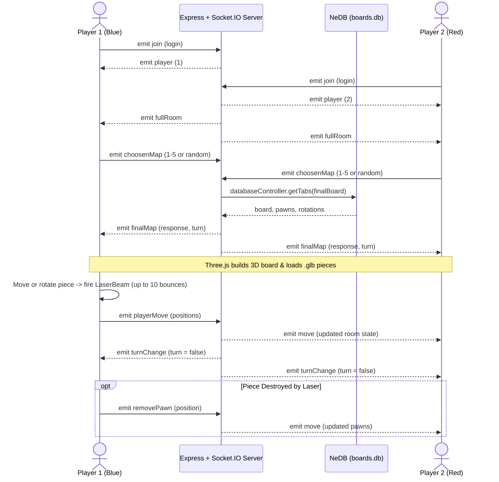

# Laser Chess 3D

[](https://nodejs.org/)
[](https://socket.io/)
[](https://threejs.org/)
[](https://github.com/tweenjs/tween.js)
[](https://github.com/louischatriot/nedb)

A real-time two-player **3D multiplayer Laser Chess** game powered by **Node.js**, **Socket.IO**, **Three.js**, **Tween.js**, and **NeDB**. Outmaneuver your opponent by moving and rotating reflective 3D pieces across selectable board layouts, then fire a raycasted laser beam that bounces across mirrors to eliminate enemy pieces and strike the opposing King.

---

## Overview & Features

- **Real-Time 2-Player Multiplayer**: Automatic 2-player matchmaking into Socket.IO rooms (`room0`, `room1`, ...) with live turn enforcement and board synchronization.
- **Interactive Board Voting**: Before each match, both players vote on **5 preset 10×8 board layouts** (with preview thumbnails) or **Random**, resolved server-side via tie-breaking logic and loaded from an embedded **NeDB** datastore (`boards.db`).
- **Full 3D WebGL Board & Custom `.glb` Models**: Every board tile and chess piece is rendered in 3D using Three.js `GLTFLoader`, lit with directional lighting, and freely inspectable with `OrbitControls`.
- **Recursive 3D Laser Raycasting**: After each turn, the active player's corner emitter fires a volumetric laser beam (`LaserBeam`) supporting up to **10 consecutive mirror reflections** computed with surface-normal vector reflections (`THREE.Raycaster` + `Vector3.reflect`) and dynamic hit-point lighting.
- **Smooth Animations**: Piece sliding and piece-destruction shatter animations are driven by **Tween.js**.

---

## Gameplay Rules & Controls

### Match Setup

1. Open the app in two browser tabs/windows and enter a player name in the login dialog (`LOGOWANIE` -> `LOGUJ`).
   - **Player 1** is assigned **Blue** (moves first, camera oriented on the Blue side).
   - **Player 2** is assigned **Red** (camera oriented on the Red side).
2. Once both players join the room, the **Board Selection** menu appears with 5 board previews (`plansza1.JPG`–`plansza5.JPG`) plus a **random** option.
3. Click a board and press **send**. When both players have voted, the server selects the final board and loads the 3D arena for both clients.

### Turn Actions & Controls

- **Orbit / Zoom Camera**: Drag with mouse, scroll wheel, or use arrow keys (`OrbitControls`).
- **Select a Piece**: Left-click one of your team's 3D pieces on your turn.
  - The selected piece highlights **yellow**.
  - Valid adjacent empty tiles (orthogonally and diagonally, respecting color-restricted squares) highlight **green**.
  - Rotation controls (`<-` / `->`) appear at the bottom of the screen.
- **Execute Your Turn** (choose one action per turn):
  - **Move**: Click any green-highlighted tile to slide the piece onto that square.
  - **Rotate**: Click `<-` (counter-clockwise 90°) or `->` (clockwise 90°) to reorient the piece.
- **Automatic Laser Fire**: Immediately after your move or rotation completes, your corner laser fires across the board and resolves hits before passing the turn to your opponent.

### 3D Pieces & Laser Interactions

| Piece Model | Role & Laser Behavior |
| :--- | :--- |
| `laser.glb` | Corner laser emitter (stationary) that fires at the end of its owner's turn |
| `king.glb` | Team King — hitting the opponent's King immediately wins the match |
| `mirror.glb` | Double-sided mirror that reflects incoming laser beams at 90° |
| `shelder.glb` | Angled deflector piece with reflective and vulnerable faces |
| `shield.glb` | Armored defender that blocks beams on its shielded face (`block`) and is destroyed on vulnerable sides (`vuln`) |
| `disruptor.glb` / `sentry.glb` | Additional 3D piece models supported by the loader (used in extended board layout #6 in `boards.db`) |

- **Reflective Surface**: Bounces the beam up to 10 times (`reflectMax: 10`).
- **Armored Surface (`block`)**: Stops the laser beam safely.
- **Vulnerable Surface (`vuln`)**: Shatters and removes the piece with a 3D scatter animation, synced across clients via `removePawn`.
- **King Hit (`king`)**: Triggers the end-game victory screen (`wygral czerwony` / `wygral niebieski`).

---

## Architecture & Multiplayer Flow



---

## Tech Stack

| Layer | Technology |
| :--- | :--- |
| **Backend Server** | Node.js, Express `4.18` |
| **Real-Time Transport** | Socket.IO `4.5` (server npm package + CDN client) |
| **Database** | NeDB `1.8` (file-backed JSON datastore in `boards.db`) |
| **3D Rendering** | Three.js (WebGLRenderer, Raycaster, `GLTFLoader`, `OrbitControls`) |
| **Animations** | Tween.js `18.6` (`@tweenjs/tween.js` + `static/libs/tween.umd.js`) |
| **Frontend** | Vanilla ES Modules, HTML5, CSS3 |

---

## Project Structure

```text
laserChess/
├── server.js                      # Express static server, Socket.IO room & turn handler
├── Data.js                        # Room state model (players, board, pawns, rotations, turn)
├── boards.db                      # NeDB datastore storing preset board matrices & layouts
├── controllers/
│   └── userController.js          # Board vote resolution, move/rotation & piece removal logic
├── database/
│   └── databaseController.js      # NeDB query wrapper for fetching board configurations
├── static/
│   ├── index.html                 # Main page (login modal, board selector, rotation HUD)
│   ├── style/main.css             # UI overlays & embedded font styling
│   ├── images/plansza1-5.JPG      # Board layout preview thumbnails
│   ├── libs/                      # Vendored Three.js, GLTFLoader, OrbitControls & Tween.js
│   ├── models/*.glb               # 3D models (pieceMap, laser, king, mirror, shelder, shield, etc.)
│   └── scripts/
│       ├── Main.js                # Socket.IO client bootstrap & Game/Ui initialization
│       ├── Game.js                # 3D board/pawn builder, raycasting, move validation & turns
│       ├── Laser.js               # Recursive 3D volumetric laser beam & reflection physics
│       ├── WebGl.js               # Three.js scene, camera, lighting, OrbitControls & Tween helpers
│       ├── Net.js                 # Socket.IO event emitters & HTTP helpers
│       ├── Ui.js                  # Login, waiting prompts, board picker, arrows & win banner
│       ├── Pawn.js                # GLTF 3D piece loader
│       └── Cube.js                # GLTF 3D board tile loader
└── package.json                   # Dependencies and start script
```

---

## Getting Started

### Prerequisites

- **Node.js** (v14+ / v16+ recommended) and **npm**

### Installation

```bash
git clone https://github.com/Dudek03/laserChess.git
cd laserChess
npm install
```

### Configuration

The server listens on port `3000` by default. You can override it with the `PORT` environment variable:

```bash
# PowerShell
$env:PORT=3000; npm start

# Bash / macOS / Linux
PORT=3000 npm start
```

### Running the Game

```bash
npm start
```

1. Open `http://localhost:3000` in **two separate browser windows or tabs** (or on two devices on the same network).
2. Log in with two different player names.
3. Choose a board layout on both clients and click **send** to start playing!

> **Note:** The client loads Socket.IO from `cdn.socket.io` in `static/index.html`, so an internet connection is required when loading the page in the browser.
